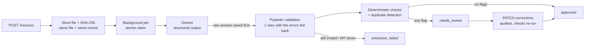

# Invoice Extraction Pipeline

[](https://github.com/viditrailko-del/invoice-extraction-pipeline/actions/workflows/tests.yml)

A backend service that turns invoice PDFs and photos into validated, structured data
with an LLM (Gemini), and is built to be **safe when the LLM is wrong**.

The LLM call is the easy part. This project is about the reliability layer around it:
every number is re-checked in code, every answer is stored before it's parsed, every
human correction is audited, and an eval harness measures how often a wrong extraction
would slip through unnoticed.

Built with [Claude Code](https://claude.com/claude-code) as a pair programmer. I made
the design and scope decisions, verified the real-receipt labels by hand, and reviewed
the changes.

## How it works



- **Retries with a fallback model.** Overloads and timeouts are retried with backoff,
  then the fallback model is tried. A quota exhausted for the day goes straight to the
  fallback, and a bad request is never retried.
- **Every LLM call is stored** in `extraction_runs` (raw text, model, prompt version,
  latency, tokens, cost) *before* parsing.
- **Output that fails the schema is retried once**, with the validation errors sent
  back to the model.
- **Nothing crashes:** any failure ends as `extraction_failed`, which can be retried.
- **Auto-approval only with zero flags.** A warning or an error sends the invoice to a
  human.

## The checks: never trust LLM math

All checks are pure functions, `(ExtractedInvoice) -> list[Flag]`, with no database or
network. That makes them easy to unit-test and to re-run after a correction.

| Check | Catches |
|---|---|
| `missing_field` | no invoice number, vendor or total |
| `line_math` | qty × unit price ≠ line amount (a discount applied inside the lines is accepted) |
| `subtotal_mismatch` / `total_mismatch` | totals that don't add up. Tax *added* vs *included* comes from the document (`prices_include_tax`), never from the country. |
| `tax_line_math` / `tax_breakdown_mismatch` / `tax_base_mismatch` | a tax table row where base × rate ≠ tax, rows that don't sum to the tax, or bases + tax ≠ total |
| `tax_id_invalid` | a vendor tax ID that fails its check digit (EU VAT, UK VAT, PT NIF, IN GSTIN, …, via `python-stdnum`). Only applied when the document shows the country. |
| `due_before_invoice` / `date_implausible` | impossible dates |
| `negative_amount` | negative values (a warning: credit notes exist) |
| `duplicate` | the same vendor + invoice number seen in a *different* file |

Money is always `Decimal` and compared with a 1-cent tolerance. The Pydantic schema is
the single source of truth: it generates the response schema Gemini must follow (money
fields are JSON numbers only) and validates what comes back.

## Eval harness

```bash
docker compose run --rm -T api uv run --frozen python -m eval.run extract    # calls Gemini once per fixture
docker compose run --rm -T api uv run --frozen python -m eval.run score latest  # offline, free, re-runnable
```

`extract` calls Gemini through the **same code path as the API** and freezes the raw
answers. `score` compares them with hand-checked labels, so a change to a check can be
measured on old answers at no API cost.

**Fixtures:** 41 labeled invoices.
- **31 synthetic:** generated from data first, so their labels are exact. They cover 10
  vendors in 8 countries, PDF, PNG and scanned JPG files, multi-page invoices, and
  planted errors.
- **10 real:** phone photos of Portuguese till receipts, labeled by hand from the photo
  and human-verified.

**Headline metric: unsafe approvals.** These are invoices with a wrong critical field
(money, dates, invoice number, vendor, tax ID) that would still be auto-approved.

### Results

Run `20261111-061513-v3`: `gemini-3.5-flash-lite`, prompt v3, all 41 fixtures.

| | Synthetic (31) | Real (10) | All |
|---|---|---|---|
| Field accuracy | 99.9% | 96.7% | 99.2% |
| Critical-field accuracy | 100% | 97.9% | 99.5% |
| Planted errors flagged (recall) | 100% | — | 100% |
| Correct auto-approvals | 19 | 6 | 25 |
| Sent to review, rightly | 12 | 1 | 13 |
| Needless reviews | 0 | 2 | 2 |
| **Unsafe approvals** | **0** | **1** | **1** |
| Extraction failures | 0 | 0 | 0 |
| Latency p50 / p95 | 2.9 s / 10.5 s | 3.7 s / 4.4 s | 3.1 s / 10.5 s |
| Cost per invoice | $0.0017 | $0.0016 | $0.0017 |

- **The one unsafe approval (pt-09):** the model returned
  "Sistels - Marques e Mascarenhas, Unip. Lda", the trading and legal names combined.
  The label accepts either name alone. Arguably the answer is right, but it's counted
  honestly.
- **Needless reviews:**
  - **pt-03** prints two self-consistent readings of its totals.
  - **pt-05:** the model misread whether tax is included, and the total check correctly
    caught the inconsistent extraction.

**Caveats:**
- These are `flash-lite` numbers. The main model (`gemini-3.5-flash`) hasn't been
  measured on the full set: the free tier allows 20 requests a day, fewer than the 41
  fixtures.
- 41 invoices is a small sample, and the real receipts are all Portuguese.

### Sample output

Both taken from the saved answers of the run above; no new API calls.

**Approved** (`syn-001`, a synthetic UK invoice, 1.9 s, $0.0014). Every number re-checks
in code (3 × line math, 1377.95 + 275.59 = 1653.54, a valid GB VAT check digit), so it
has zero flags:

```json
{
  "invoice_number": "NW-2026-3800",
  "invoice_date": "2026-10-31",
  "due_date": "2026-11-14",
  "vendor": {"name": "Northwind Cloud Services Ltd.", "tax_id": "GB123456727", "...": "..."},
  "currency": "GBP",
  "line_items": [
    {"description": "Database instance db.m5", "quantity": "1",   "unit_price": "246.03", "amount": "246.03"},
    {"description": "Domain renewal",          "quantity": "5",   "unit_price": "14.99",  "amount": "74.95"},
    {"description": "Support hours",           "quantity": "9.5", "unit_price": "111.26", "amount": "1056.97"}
  ],
  "subtotal": "1377.95",
  "tax": "275.59",
  "tax_breakdown": [{"rate": "20", "base": null, "amount": "275.59"}],
  "total": "1653.54",
  "prices_include_tax": false
}
```
→ `status: approved`, `flags: []`

**Flagged** (`pt-02`, a real phone photo of a Portuguese bakery receipt). The model
misread two smudged digits. Both answers look plausible, and the receipt's total still
adds up, but the checks catch them:

```json
{
  "vendor": {"name": "Nova Gama Gourmet SA", "tax_id": "501415926"},
  "tax": "2.71",
  "tax_breakdown": [
    {"rate": "23", "base": "12.89", "amount": "2.96"},
    {"rate": "6",  "base": "2.55",  "amount": "0.15"}
  ],
  "total": "18.55",
  "prices_include_tax": true
}
```
→ `status: needs_review`

| code | field | reason |
|---|---|---|
| `tax_breakdown_mismatch` | `tax` | Tax rows sum to 3.11, but tax is 2.71 |
| `tax_id_invalid` | `vendor.tax_id` | 501415926 fails the check digit of a NIF (Portuguese VAT number): likely a misread digit |

Both flags point at real errors: the printed values are 3.11 and 501419926.

### What the eval found, and what changed

Each fix below was found by the harness, then verified by it.

| Finding | Fix | Effect |
|---|---|---|
| A smudged digit (2,96 read as 2,56) gave a wrong tax, and nothing flagged it, because tax-included totals never involve the tax amount (pt-02) | New `tax_breakdown` field (prompt v3) and checks on each tax row | The same misreading is now caught every time |
| A misread vendor NIF, 501419926 read as 501415926 (pt-02) | Check-digit validation via `python-stdnum` | Caught |
| `flash-lite` returned money as `"2,79"` and quantities as `"1 C"`. Pydantic's default `Decimal` schema allows any string. | Money and quantities are sent to Gemini as JSON numbers only | Validation errors 3 → 0 and real-receipt field accuracy 81% → 97.6% (same 10 receipts) |
| A daily quota error was retried 3× before falling back (~15 s per invoice) | A per-day 429 is now treated as permanent, while a per-minute 429 is still retried | Goes straight to the fallback |
| A correct receipt with a per-line discount was flagged (pt-05) | Line gaps that add up to the printed discount are accepted | 2 false alarms removed; re-scored on all saved runs with no new unsafe approvals |

## Running it

Requirements: Docker. Everything runs in containers.

```bash
cp .env.example .env            # then set GEMINI_API_KEY
docker compose up -d --wait     # Postgres + API with auto-reload, http://localhost:8000/docs
docker compose run --rm -T api uv run --frozen alembic upgrade head
docker compose run --rm -T api uv run --frozen pytest -q     # never calls Gemini
```

### API

| Method & path | What it does |
|---|---|
| `POST /invoices` | upload a PDF/PNG/JPG; extraction runs in the background |
| `GET /invoices?status=needs_review` | the review queue |
| `GET /invoices/{id}` | extracted data, corrected data, flags |
| `PATCH /invoices/{id}` | correct fields (all-or-nothing, audited, checks re-run) |
| `POST /invoices/{id}/flags/{flag_id}/resolve` | a human accepts a flagged value |
| `POST /invoices/{id}/reject` | final rejection |
| `GET /invoices/{id}/corrections` | audit trail |
| `POST /invoices/{id}/retry` | re-run a failed extraction |
| `GET /health` | process and database |

```bash
curl -F "file=@invoice.pdf;type=application/pdf" localhost:8000/invoices
curl -X PATCH localhost:8000/invoices/$ID -H 'content-type: application/json' \
  -d '{"corrected_by": "alice", "changes": [{"field_path": "total", "value": "1653.54"}]}'
```

`extracted_json` (the LLM's answer) is never modified. Corrections go to
`corrected_json` plus one `corrections` row per changed field.

### Production image

```bash
docker build -t invoice-api .                              # the default target is the production image
docker run --rm -e DATABASE_URL=... invoice-api alembic upgrade head   # once per deploy
docker run -d -p 8000:8000 -e DATABASE_URL=... -e GEMINI_API_KEY=... \
  -v invoice-files:/app/storage invoice-api
```

- Contains runtime dependencies only (no `uv`, tests or fixtures), runs as a non-root
  user, has a Docker `HEALTHCHECK` on `/health`, and is about 430 MB versus 720 MB for
  the dev image.
- **JSON logs, one event per line.** Every extraction ends with an `extraction_finished`
  event that records the status, model, LLM calls and failures, latency, tokens,
  `cost_usd` and flag codes. Failed calls (`llm_call_failed`) and invalid output
  (`llm_output_invalid`) are logged as they happen. Set `LOG_FORMAT=text` for
  `key=value` lines.
- **A missing `GEMINI_API_KEY` doesn't break uploads.** It's logged at startup, uploads
  are still stored, and extractions end as `extraction_failed` until the key is set.

## Known limits

- **Single API instance.** Jobs run in FastAPI background tasks, and `recover_stuck_jobs`
  re-queues interrupted ones at startup. That is only safe with one instance; several
  would need a real job queue.
- **No authentication.** Reviewers name themselves in the request body.
- **Local file storage** (a volume), not object storage.
- **Duplicate detection** misses vendor names that differ beyond legal suffixes (Ltd,
  Inc, …), and two copies processed at the same moment.

## Data attribution

The real receipt fixtures come from *"Dataset of personal invoices and receipts
including annotation of relevant fields"*, [Zenodo record 7213544](https://zenodo.org/records/7213544),
licensed [CC BY 4.0](https://creativecommons.org/licenses/by/4.0/).

The images are not redistributed here because they show a private buyer's tax number.
`python -m scripts.fetch_real_fixtures` downloads them and verifies their checksums.
The labels in `eval/fixtures/real/` are our own and were checked by hand.

## License

Code: [MIT](LICENSE). The receipt dataset keeps its own CC BY 4.0 license (see above).
